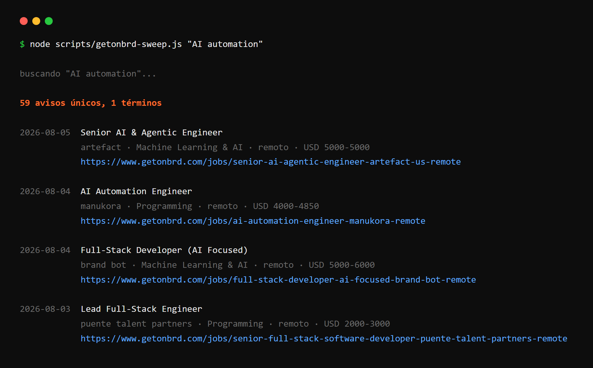
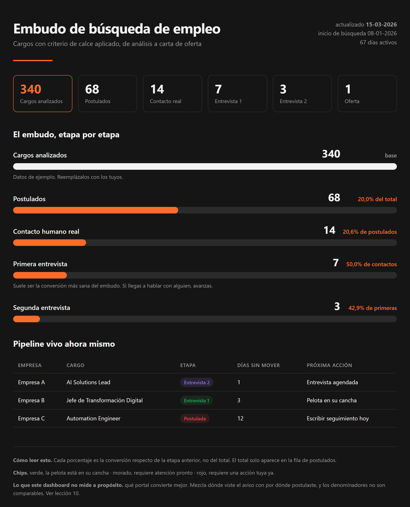

# applyOS

Sistema de búsqueda de empleo asistido por IA. Barre varios portales, analiza el calce real de cada aviso contra tu perfil leyendo la descripción completa en vez del título, y te entrega un reporte en formato embudo para saber en qué etapa se te cae cada proceso.

Corre sobre [Claude Code](https://claude.com/claude-code) como [cuatro skills](#cómo-usarlo-como-skills-de-claude-code) (o como comando de barra), más un par de scripts en Node y PowerShell.

> **applyOS es una plantilla.** Tu perfil, tu tracker, tus CVs y tus barridos viven fuera del repo, en tu propia carpeta de búsqueda, y los archivos donde irían están en el `.gitignore`. Lo que se comparte acá es el sistema, nunca los datos de nadie.

> **Por qué existe.** Buscar trabajo a mano no escala. Revisar 600 avisos, decidir cuáles valen la pena y adaptar el CV a cada uno es un trabajo de tiempo completo sin sueldo. Y peor, lo haces a ciegas. No sabes si el problema es tu perfil, el mercado o el canal.

### 👉 [Empieza acá. Guía paso a paso](GUIA.md)  ·  [Requisitos](REQUISITOS.md)  ·  [Instalar las skills](docs/INSTALACION-SKILLS.md)  ·  [Diarizar entrevistas](docs/DIARIZAR-ENTREVISTAS.md)  ·  [Cambios](CHANGELOG.md)

---

## El barrido

Un término, 59 avisos únicos, deduplicados y ordenados por fecha. Sin llaves de API.



## El reporte de embudo

Cada etapa con su conversión respecto de la anterior, más el pipeline vivo con los días sin movimiento y la próxima acción de cada proceso. Se exporta a PDF.



*(Datos de ejemplo.)*

---

## Qué hace

**Barre los portales.** Get on Board vía API, LinkedIn, Computrabajo y portales locales. Configurable.

**Muestra solo lo nuevo.** Cada barrido se compara contra el anterior (barrido delta), así la revisión a fondo se gasta en lo que no habías visto. Y avisa cuando estás comparando contra una salida vieja, que es la forma más común de que un barrido "no encuentre nada".

**Ignora el título del aviso.** Los títulos son un desastre. En un barrido real aparecieron más de 10 nombres distintos para funciones casi idénticas (AI Specialist, Forward Deployed Engineer, GTM Engineer, Automation Engineer, AI Solutions Lead), con sueldos de USD 1.500 a 5.000 al mes sin ningún patrón. applyOS lee la descripción completa y clasifica cada aviso en una **familia de función** que tú defines.

**Verifica en dos niveles.** Descartar todo por título es rápido y caro. En una prueba, de 24 avisos descartados solo por el título, 3 escondían un calce real. Por eso hay una regla explícita de qué se puede descartar sin abrir y qué obliga a leer el detalle.

**Deduplica contra lo ya postulado.** Cruza por la palabra distintiva de la empresa, no por empresa más título exacto, porque las empresas republican el mismo cargo con nombres distintos. Y no confunde "empresa conocida" con "cargo cubierto".

**No confunde un bloqueo con un mercado vacío.** Un 403 o un 429 se reintenta con pausa y con otro método, y si sigue fallando se reporta como BLOQUEADO, nunca como cero avisos.

**Registra todo.** Cada aviso tocado deja una fila con su motivo, y cada barrido deja una fila con portales, conteos y bloqueos. Los calces sin decisión vuelven a aparecer en cada informe hasta que decidas.

**Reporta en embudo.** Analizados, postulados, contacto humano, primera entrevista, segunda entrevista. Con la conversión de cada etapa respecto de la anterior.

**Trae un escáner de secretos y datos personales.** Si vas a publicar tu propia versión, `herramientas/escanear.js` frena el commit si encuentra claves, correos, teléfonos, rutas de tu computador o nombres que tú definas.

---

## Requisitos

| Requisito | Para qué |
|---|---|
| **Node.js 22+** | los scripts de barrido, delta, escáner y PDF |
| **[Claude Code](https://claude.com/claude-code)** | análisis de calce, CVs adaptados y reporte de embudo. **Es de pago** |
| Google Chrome | solo si quieres exportar el dashboard a PDF |
| PowerShell 5.1+ | opcional, versión alternativa del barrido en Windows |

No necesitas llaves de API. Todas las fuentes son endpoints públicos.

### Qué funciona sin Claude Code

| | Solo con Node | Necesita Claude Code |
|---|---|---|
| Barrido de Get on Board | ✅ | |
| Barrido delta y cruce contra el tracker | ✅ | |
| Escáner de secretos y datos personales | ✅ | |
| Barrido de LinkedIn y portales locales | | ✅ |
| Clasificación por familias y análisis de calce | | ✅ |
| Verificación en dos niveles | | ✅ |
| CV adaptado a cada aviso | | ✅ |
| Reporte de embudo | | ✅ |
| Exportar el dashboard a PDF | ✅ | |

El barrido solo te trae avisos, y eso lo hace cualquier portal. **El valor está en lo que viene después**, y eso corre sobre Claude Code.

## Cómo usarlo como skills de Claude Code

Desde la versión 1.2.0, applyOS viene también como **cuatro skills** de Claude Code. Una skill es una carpeta con un `SKILL.md` corto, más `scripts/` y `references/`. Claude la activa solo cuando lo que pides coincide con su descripción, y carga los detalles largos únicamente cuando los necesita, así que gasta menos contexto que un comando largo.

### Instalación en 3 pasos

1. Clona el repo: `git clone https://github.com/<usuario>/applyos.git`
2. Instala las skills. En Windows `.\instalar.ps1`, en macOS, Linux o Git Bash `./instalar.sh`. Te pregunta si las quieres en tu usuario (`~/.claude/skills`, valen para todo) o en un proyecto (`<proyecto>/.claude/skills`). No sobrescribe nada sin avisar: si una skill ya existe la salta, y con `-Forzar` (o `FORZAR=1`) la respalda antes de reemplazarla.
3. Edita `~/.applyos/config.json` con las rutas de tu perfil, tu CV maestro, tu tracker y tus grabaciones. El instalador deja un archivo de ejemplo si no existe. Ese archivo vive fuera del repo, así que tus datos nunca se publican.

Detalle, instalación manual y solución de problemas en [`docs/INSTALACION-SKILLS.md`](docs/INSTALACION-SKILLS.md).

### Qué hace cada skill

| Skill | Qué hace | Frases que la activan |
|---|---|---|
| `applyos-busqueda` | Barre portales, lee la descripción completa, clasifica el calce, deduplica contra el tracker y registra todo | "haz un barrido de empleos", "qué hay nuevo hoy", "¿este cargo calza conmigo?" |
| `applyos-postulacion` | Tabla de requisitos, CV adaptado desde tu maestro, respuestas de formularios, correo listo y registro | "prepara la postulación a este cargo", "adapta mi CV a este aviso", "redacta el correo" |
| `applyos-entrevista` | Playbook antes de la entrevista y evaluación después, con diarización y métricas | "tengo entrevista el jueves, prepárame", "evalúa esta entrevista", "diariza este audio" |
| `applyos-embudo` | Reporte del embudo por etapa, dashboard, PDF e informe de cierre | "genera el reporte de embudo", "cómo va mi búsqueda", "informe de cierre" |

### Qué hace la IA y qué haces tú

| La IA | Tú |
|---|---|
| Barre los portales y lee las descripciones completas | Defines tu perfil, tus familias de cargo y tus no negociables |
| Clasifica el calce y marca los gaps | Decides cuáles postular |
| Adapta el CV con tu material real, sin inventar | Revisas el PDF y confirmas que es verdad |
| Redacta correos y respuestas de formularios | Envías tú, y avisas cuando lo hiciste |
| Calcula métricas de la entrevista desde la transcripción | Grabas con consentimiento de los demás participantes y verificas las citas |
| Propone máximo dos correcciones | Las practicas |
| Arma el embudo desde tu tracker | Mantienes el tracker al día |

### Qué corre en tu PC y qué no

- **En tu PC.** Los scripts de Node (barrido, delta, métricas, PDF), el instalador, el escáner, tus archivos y el tracker.
- **Hacia internet.** Los barridos consultan portales públicos. `diarizar.js` sube el audio a AssemblyAI y ahí queda según su política de retención (ver [`docs/DIARIZAR-ENTREVISTAS.md`](docs/DIARIZAR-ENTREVISTAS.md)). El texto que Claude lee y escribe pasa por el servicio de Claude.
- **No sale nunca de tu equipo por este repo.** Tu perfil, tu CV, tu tracker y tus grabaciones.

### Requisitos

Claude Code (de pago), Node.js 22 o superior (la diarización solo pide Node 18), Chrome o Edge si quieres PDF y, para diarizar, una cuenta de AssemblyAI con su clave en la variable de entorno `ASSEMBLYAI_API_KEY`. Más en [`REQUISITOS.md`](REQUISITOS.md).

### Skill o comando, cuál es la diferencia

`skill/empleos.md` es el **comando de barra** original (`/empleos`): un solo archivo largo que se carga entero cada vez que lo invocas, y que tú lanzas a mano. Las **skills** son carpetas, se activan solas por su descripción, empaquetan sus scripts y leen los detalles solo cuando hacen falta. El comando sigue en el repo por compatibilidad, y `instalar.ps1 -ConComando` lo instala si lo quieres. Son la misma metodología: si usas las skills, no necesitas el comando.

Los scripts y documentos originales siguen en la raíz del repo, y las skills llevan una copia para poder instalarse copiando una carpeta. `node herramientas/sincronizar-skills.js` las mantiene al día y `--verificar` comprueba que no haya diferencias.

---
## Instalación

```bash
git clone https://github.com/<usuario>/applyos.git
cd applyos
npm install
```

Después sigue la [guía](GUIA.md). En corto, creas tu carpeta de búsqueda **fuera del repo**, copias ahí la skill y las plantillas, y las llenas.

```bash
cp perfil.ejemplo.md      ../mi-busqueda/perfil.md
cp portales.ejemplo.md    ../mi-busqueda/portales.md
cp portales.ejemplo.json  ../mi-busqueda/portales.json
cp tracker.ejemplo.md     ../mi-busqueda/tracker.md
cp cv/cv-maestro.ejemplo.html ../mi-busqueda/cv-maestro.html
```

**Si de todos modos trabajas dentro del repo, esos archivos están en el `.gitignore` a propósito.** Ahí van tus datos, tu expectativa de renta y tu CV. Eso no se publica nunca.

## Los archivos que tienes que llenar

**`perfil.md`** es el que más pesa. Define quién eres, **qué quieres hacer realmente** (que no es lo mismo que el título del cargo), tus no negociables, tus familias de cargo, la categoría puente si la quieres, tu movilidad y hasta dónde llega tu techo de seniority. Sin esto el barrido devuelve ruido. Mira [`perfil.ejemplo-lleno.md`](perfil.ejemplo-lleno.md), un perfil ficticio completo.

**`portales.md` y `portales.json`** definen dónde y con qué términos buscar. El `.md` es la guía para la skill, el `.json` lo leen los scripts. Vienen con LATAM configurado, pero Computrabajo funciona en 14 países cambiando el subdominio y LinkedIn es global.

**`tracker.md`** es la memoria del sistema. Procesos, descartes con motivo, decisiones pendientes, anclas de renta y registro de barridos. Es la fuente del dedup y del embudo.

**`cv-maestro.html`** es la fuente de verdad para generar cada CV adaptado. También sirve al revés, para el **análisis inverso**. En vez de preguntar si calzas con un aviso, preguntar a qué cargos calificas realmente con lo que tienes. Las reglas están en [`cv/ESTANDAR-CV.md`](cv/ESTANDAR-CV.md).

---

## Uso

```
/empleos                    # barrido completo
/empleos [término]          # agrega un término puntual al barrido
```

Los scripts también corren solos, sin Claude Code.

```bash
node scripts/getonbrd-sweep.js                                   # barrido con los términos de portales.json o los de ejemplo
node scripts/getonbrd-sweep.js --dias 15 --json > barridos/gob-2026-03-12.json
node scripts/delta.js barridos/gob-2026-03-12.json barridos/prev-2026-03-10/gob.json --tracker tracker.md
node scripts/dashboard-pdf.js dashboard/embudo.html embudo.pdf
node herramientas/escanear.js                                    # revisa el repo antes de publicar
```

---

## Estructura

```
applyos/
├─ GUIA.md                   guía paso a paso, empieza acá
├─ REQUISITOS.md             software, hardware y costos reales
├─ LECCIONES.md              los hallazgos medidos del barrido
├─ CHANGELOG.md              historia de versiones
├─ skill/empleos.md          el comando /empleos original (compatibilidad)
├─ .claude/skills/           las 4 skills (busqueda, postulacion, entrevista, embudo)
├─ instalar.ps1 · instalar.sh   instalan las skills sin sobrescribir
├─ config.ejemplo.json       modelo de ~/.applyos/config.json
├─ docs/                     instalación de skills y diarización de entrevistas
├─ perfil.ejemplo.md         quién eres, qué quieres, familias, no negociables
├─ perfil.ejemplo-lleno.md   un perfil ficticio completo, para ver el nivel de detalle
├─ portales.ejemplo.md       portales por país y sus trampas
├─ portales.ejemplo.json     términos y parámetros que leen los scripts
├─ tracker.ejemplo.md        pipeline, descartes, decisiones, anclas y registro de barridos
├─ cv/
│  ├─ cv-maestro.ejemplo.html   plantilla de CV compatible con filtros ATS
│  └─ ESTANDAR-CV.md            tailoring, palabras clave sin mentir, formato y análisis inverso
├─ entrevistas/
│  ├─ PREPARACION.md            qué hacer antes de cada entrevista
│  ├─ GRABACION.md              grabar sin ser admin de la reunión, y transcribir
│  ├─ EVALUACION.md             cómo evaluarte después, con métricas duras
│  └─ LECCIONES-ENTREVISTAS.ejemplo.md   tus patrones acumulados
├─ dashboard/embudo.ejemplo.html
├─ herramientas/
│  ├─ escanear.js               escáner de secretos y datos personales
│  ├─ pre-commit                hook que corre el escáner antes de cada commit
│  └─ sincronizar-skills.js     copia scripts y docs a las skills
└─ scripts/
   ├─ getonbrd-sweep.js  ·  getonbrd-sweep.ps1
   ├─ delta.js                  barrido delta y cruce contra el tracker
   (los scripts de diarización y métricas viven en .claude/skills/applyos-entrevista/scripts)
   ├─ dashboard-pdf.js
   └─ linkedin-sweep.md
```

---

## El ciclo no termina cuando envías el CV

Buscar trabajo tiene dos mitades y casi todas las herramientas cubren solo la primera.

**La primera mitad se automatiza.** Barrer, filtrar, deduplicar, adaptar el CV. Es volumen y criterio repetible.

**La segunda no.** Prepararte para una entrevista, evaluarte honestamente después, y convertir eso en un cambio de comportamiento concreto. Esa mitad es donde se decide si consigues el trabajo, y es la que la mayoría hace de memoria y a ojo.

Por eso el repo trae [`entrevistas/PREPARACION.md`](entrevistas/PREPARACION.md), [`entrevistas/GRABACION.md`](entrevistas/GRABACION.md) y [`entrevistas/EVALUACION.md`](entrevistas/EVALUACION.md). El tercero tiene el método completo. Separar el resultado del proceso de la calidad de tus respuestas, sacar métricas duras del transcript, y las trampas de pedirle a una IA que te evalúe.

---

## Lee esto antes de escribir tu propia versión

[`LECCIONES.md`](LECCIONES.md) tiene los hallazgos medidos que hacen que un barrido funcione o no sirva para nada. Entre ellos, por qué buscar por stack en LinkedIn no encuentra nada, por qué `location=Remote` no significa remoto, cuánto cuesta una ventana de 7 días, y por qué un cero en un portal casi nunca es un cero.

Si vas a construir algo parecido, esa página te ahorra semanas.

---

## Si publicas tu propia versión

Antes de subir un fork con tus cambios, corre el escáner e instala el hook para que lo haga solo.

```bash
cp herramientas/pre-commit .git/hooks/pre-commit
```

Tu lista de nombres prohibidos y la ruta a tus archivos de claves se configuran con variables de entorno o con archivos fuera del repo. Nunca dentro. El detalle está en la [guía](GUIA.md#publicar-tu-propia-versión-sin-filtrar-datos).

---

## Estado

Proyecto en uso real. No es un producto ni pretende serlo. Los portales configurados son de LATAM, pero la arquitectura sirve para cualquier mercado cambiando las fuentes.

Si lo adaptas a tu país, le agregas un portal o encuentras algo que se pueda mejorar, los issues y los PR son bienvenidos.

---

## Licencia

MIT
